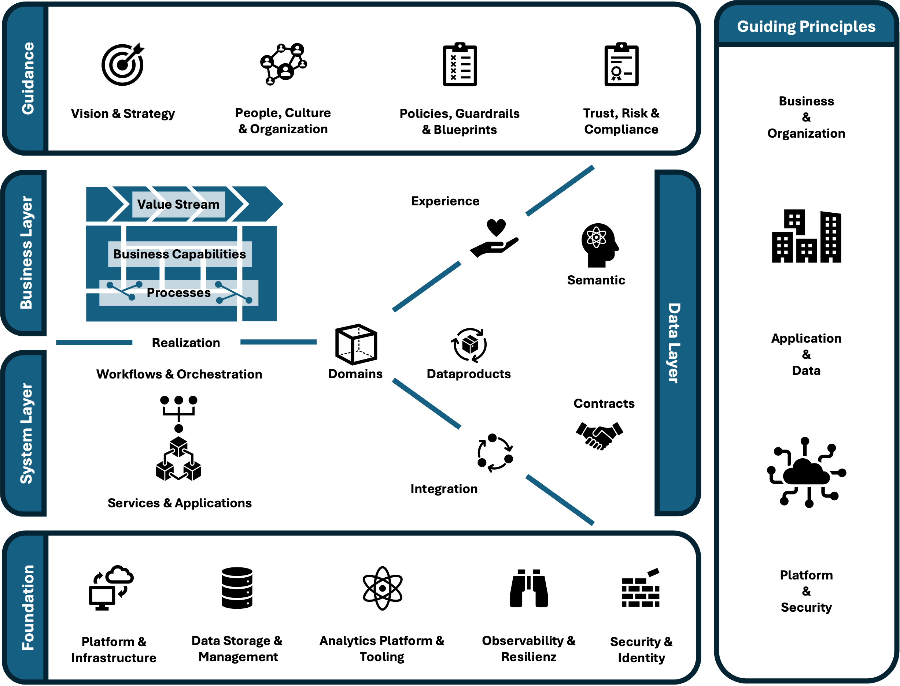

# Enterprise Landscape Model (ELM)

> A pragmatic, open reference architecture for modern enterprise landscapes.

[](model/specification.md)
[](model/specification.md)
[](LICENSE.md)

**Klassifikation:** Enterprise Architecture Framework  
**Kern-Artefakt:** Kanonisches Referenzmodell  

Hersteller- und branchenneutrales Referenzmodell, methodisches Diagnoseraster und praxistauglicher Ordnungsrahmen für nachhaltige, evolvierbare und zukunftsfähige Unternehmens- und Systemlandschaften.

---

## 1. Das Kernmodell auf einen Blick

Das **Enterprise Landscape Model (ELM)** definiert einen verbindlichen strukturellen, semantischen und organisatorischen Ordnungsrahmen. Es überwindet Silos zwischen Fachbereich, Software-Engineering und Plattformbetrieb, ohne in die administrative Bürokratie schwerfälliger Großframeworks zu verfallen.



- **Kanonische Spezifikation:** [model/specification.md](model/specification.md)
- **Vektor-Präsentationsvorlage:** [model/assets/enterprise-landscape-model.pptx](model/assets/enterprise-landscape-model.pptx)

---

## 2. Inhaltskatalog & Navigator

| Artefakt | Typ | Beschreibung & Nutzen | Quelle / Ablage | Status / Reife |
|---|---|---|---|---|
| **[Kernmodell: Spezifikation](model/specification.md)** | Referenzmodell | ELM Lean Metamodel (Formale Ontologie), fünf Tiers (`Tier 1: Guidance` bis `Tier 5: Foundation`), Entkopplungsgateways, $5 \times 5$ Interaktionsmatrix und Guiding Principles | `model/specification.md` | v0.8 (Public Preview) |
| **[Segment: Business Layer](model/segments/business-layer.md)** | Segment-Spezifikation | Vertikaler Zoom-in in Tier 2: Wertströme, Capabilities und Bounded Contexts | `model/segments/business-layer.md` | v0.1 (Entwurf) |
| **[Thematisches Overlay: AI-Readiness](overlays/ai-readiness/ai-readiness-overlay.md)** | Thematisches Overlay | Transversale Projektion über alle 5 Tiers: Prüflinse entlang D1 bis D6 mit K.o.-Kriterien | `overlays/ai-readiness/` | v0.4 (Pilotierung) |
| **[Architekturreview — Canvas](canvases/review-canvas.md)** | Canvas | Interaktive Arbeitsfläche für strukturierte Architektur-Reviews | `canvases/review-canvas.md` | v0.1 (Arbeitsvorlage) |
| **[Baustein-Vorlage](templates/baustein-template.md)** | Vorlage | Standard-Template für neue Segmente, Methoden und Linsen | `templates/baustein-template.md` | Standard |
| **[Overlay-Vorlage](templates/overlay-template.md)** | Vorlage | Standard-Template für relationale Overlays mit Tier-Projektion | `templates/overlay-template.md` | Standard |
| **[Case Review Vorlage](templates/case-review-template.md)** | Vorlage | Strukturierte Vorlage für konkrete, anonymisierte Mandanten-Reviews | `templates/case-review-template.md` | Standard |

---

## 3. Repository-Struktur

```text
enterprise-landscape-model/
├── README.md                                  # Repository-Einstieg, Navigator & Modell-Übersicht
├── LICENSE.md                                 # 100 % CC BY 4.0 Lizenzvereinbarung
│
├── model/                                     # Das Kernmodell (Enterprise Landscape Model)
│   ├── specification.md                       # Normative Spezifikation (Lean Metamodel, 5 Tiers ab Tier 1: Guidance, Gateways, Guiding Principles)
│   ├── segments/                              # Schichten-Vertiefungen (z. B. business-layer.md)
│   └── assets/                                # Grafiken & Präsentationsvorlagen
│       ├── enterprise-landscape-model.png
│       └── enterprise-landscape-model.pptx
│
├── overlays/                                  # Thematische Querschnitts-Zielbilder
│   └── ai-readiness/
│       ├── ai-readiness-overlay.md            # Spezifikation & Dimensionen (D1 bis D6)
│       └── assets/
│           └── ai-readiness-overlay.pptx
│
├── canvases/                                  # Anwendungs- & Workshop-Hilfen
│   └── review-canvas.md
│
└── templates/                                 # Standardisierte Vorlagen für Erweiterungen & Reviews
    ├── baustein-template.md
    ├── overlay-template.md
    └── case-review-template.md
```

---

## 4. Methodische Grundprinzipien

1. **Die funktionale Triade:** Jedes Artefakt trennt strikt zwischen drei funktionalen Dimensionen: *Normativ* (verbindliche Zielzustände und Leitplanken), *Diagnostisch* (auditierbare Bewertungsmaßstäbe, Prüffragen und belegbare Evidenzen) sowie *Kommunikativ* (zielgruppengerechte Vermittlung über Rollen- und Disziplingrenzen hinweg).
2. **Epistemische Disziplin:** Diagnostische Bewertungskriterien in thematischen Overlays und Architektur-Reviews weisen ihren Verbindlichkeitsstatus transparent aus: `[E]` (Etablierte Praxis aus Standards und Regulatorik), `[A]` (Abgeleitete Praxis aus empirischen Transformationsbefunden) oder `[H]` (Hypothese für explorative Entwürfe).
3. **Lean Architecture (Pull vor Push):** Architektur dient der unmittelbaren Entscheidungs- und Handlungsfähigkeit, nicht der administrativen Selbstverwaltung. Modelle, Segmente und Overlays entstehen bedarfsorientiert entlang realer Fragestellungen und verzichten auf theoretische Vorratsmodellierung.
4. **Soziotechnische Ausrichtung:** Fachdomänen (Bounded Contexts) bilden die primäre Strukturierungs- und Verantwortungsgrenze, an der Fachlichkeit (Capabilities und Prozesse), Software-Systeme und Datenhoheit (Domain Data Ownership) ausgerichtet werden.

---

## 5. Status & Weiterentwicklung

Dieses Repository befindet sich im Status **v0.8 (Public Preview)**. Der strukturelle Kern ist stabil und wird auf Basis von Praxiserfahrungen kontinuierlich verfeinert.

Vorschläge, Erweiterungen und Diskussionen werden transparent über GitHub Issues und Discussions geführt.

---

## 6. Lizenz

Dieses Repository steht unter der Lizenz **[Creative Commons Attribution 4.0 International (CC BY 4.0)](LICENSE.md)**.
